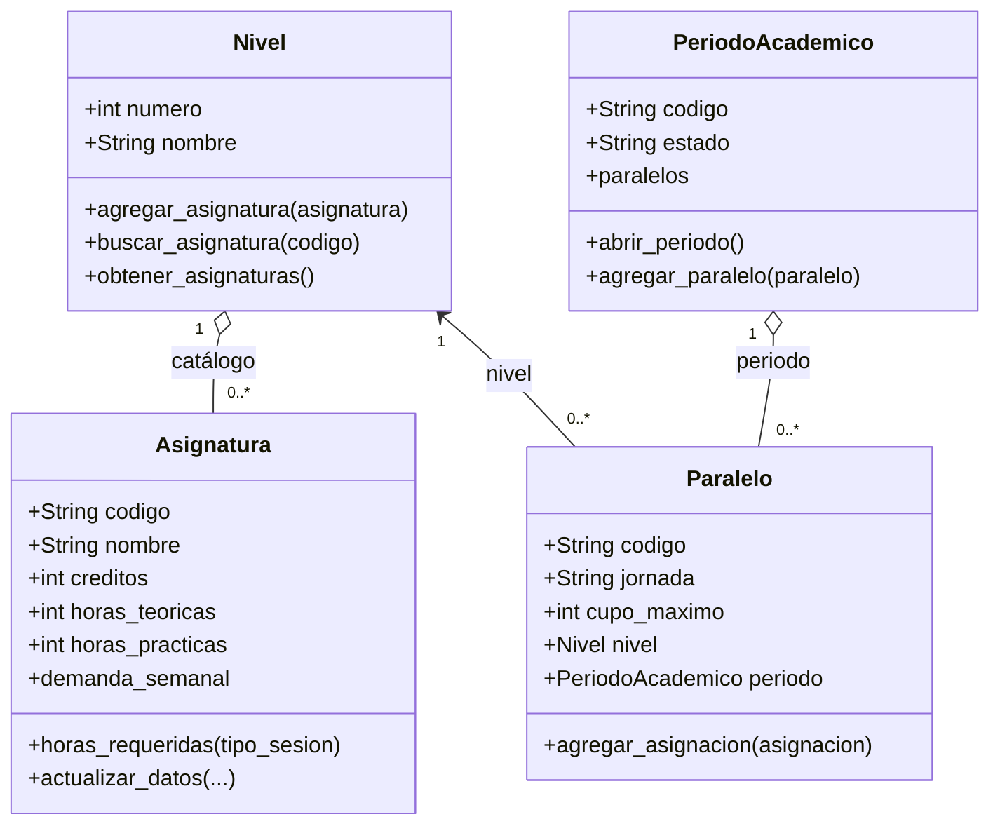

# UML del catálogo académico

Este diagrama describe los modelos académicos mantenidos por Kevin y el
contrato de demanda que puede consultar el planificador.

`Asignatura.demanda_semanal` devuelve horas semanales separadas por tipo de
sesión. La duración y cantidad de bloques se determinan en planificación
cuando el equipo acuerde la duración de bloque.

El código de paralelo se normaliza y se mantiene único dentro del periodo,
porque la persistencia JSON actual reconstruye paralelos usando ese código.
